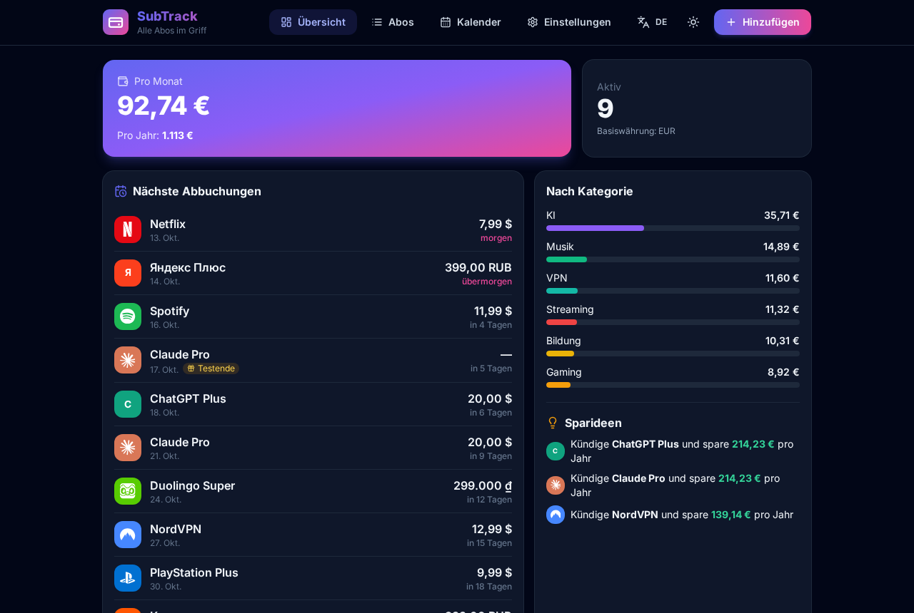

[Русский](README.md) · [English](README.en.md) · [Español](README.es.md) · [日本語](README.ja.md) · [Français](README.fr.md) · [Deutsch](README.de.md)

# SubTrack — Abo-Tracker

Eine kostenlose Open-Source-App zur Verwaltung deiner Abos auf Android und Windows. Sie funktioniert offline, ohne Registrierung, Server oder API-Schlüssel. Alle Daten bleiben auf deinem Gerät.



## Funktionen
- Abos mit Preis, Währung, Zeitraum (Woche / Monat / Jahr / eigener), Abbuchungsdatum, Kategorie, Farbe, Logo, Zahlungsmittel, Link und Notizen.
- Monatsenden werden korrekt behandelt: Ein Abo vom 31. wird in kürzeren Monaten am letzten Tag abgebucht und danach wieder am 31.
- Gratis-Tests: Enddatum mit eigener Erinnerung vor der ersten Abbuchung.
- Übersicht: Monats- und Jahressumme in deiner Basiswährung, Aufteilung nach Kategorien und Tipps wie „Kündige X und spare Y pro Jahr“.
- Monatskalender aller Abbuchungen mit Monatssumme.
- **Alle 166 Währungen** von open.er-api.com, mit lokalisierten Namen, Suche und beliebten Währungen oben. Offline nutzt die App gespeicherte Kurse oder einen eingebauten Snapshot für alle Währungen; jeder Kurs lässt sich manuell festlegen.
- Erinnerungen: lokale Benachrichtigungen auf Android, Systembenachrichtigungen unter Windows.
- 70 beliebte Dienste mit echten Simple-Icons-Logos.
- 30 Sprachen, mit RTL für Hebräisch und Arabisch.
- JSON-Export und -Import, CSV-Export für Excel oder Google Tabellen, helles und dunkles Design.

| | |
|---|---|
|  |  |
|  |  |

## Download
Dateien unter [Releases](../../releases/latest): `SubTrack-0.3.0-debug.apk` (Android), `SubTrack-Setup-0.3.0.exe` (Windows-Installer) und `SubTrack-Portable-0.3.0.exe` (ohne Installation). Die Dateien sind nicht signiert: Windows SmartScreen kann warnen („Weitere Informationen“ → „Trotzdem ausführen“), und Android muss Installationen aus unbekannten Quellen erlauben.

## Bauen
```bash
npm install
npm run dev          # http://localhost:5173
npm test
npm run dist:win     # Windows Setup + Portable (Linux: wine)
npm run android:apk  # Android debug APK (Android SDK + JDK 21)
```

Stack: React 18, Vite, Tailwind CSS, Capacitor 7, Electron, electron-builder.

## Datenschutz
Keine Konten, keine Analyse, keine Werbung, kein Backend. Die einzige Netzwerkanfrage lädt öffentliche Wechselkurse (open.er-api.com, ohne Schlüssel).

## Lizenz
MIT. Logos von [Simple Icons](https://simpleicons.org) (CC0); Marken gehören ihren Inhabern, siehe [NOTICE](NOTICE). Änderungen: [CHANGELOG](CHANGELOG.md).
