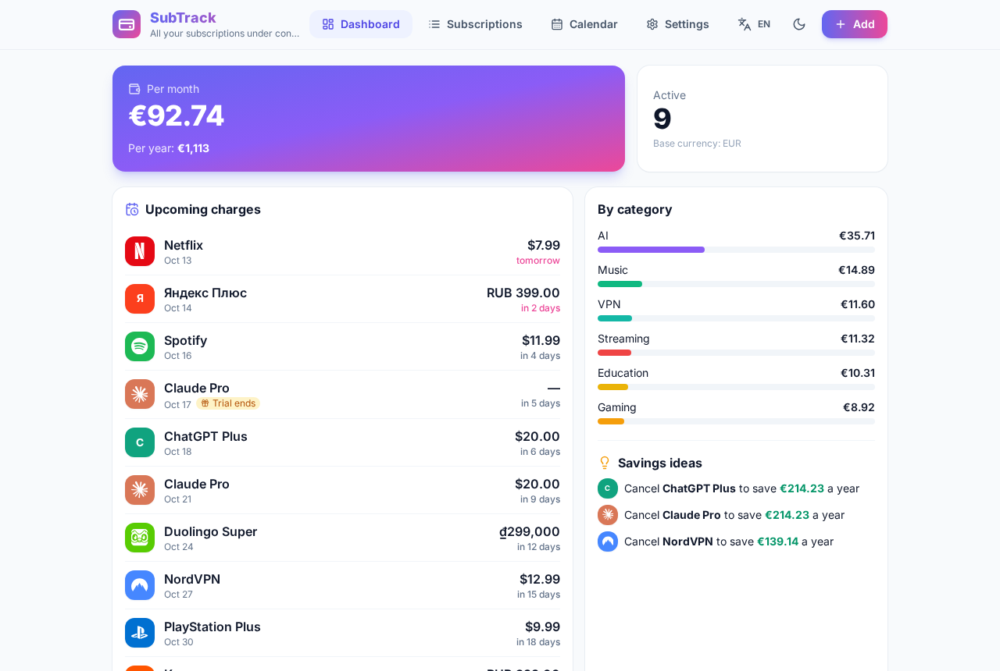
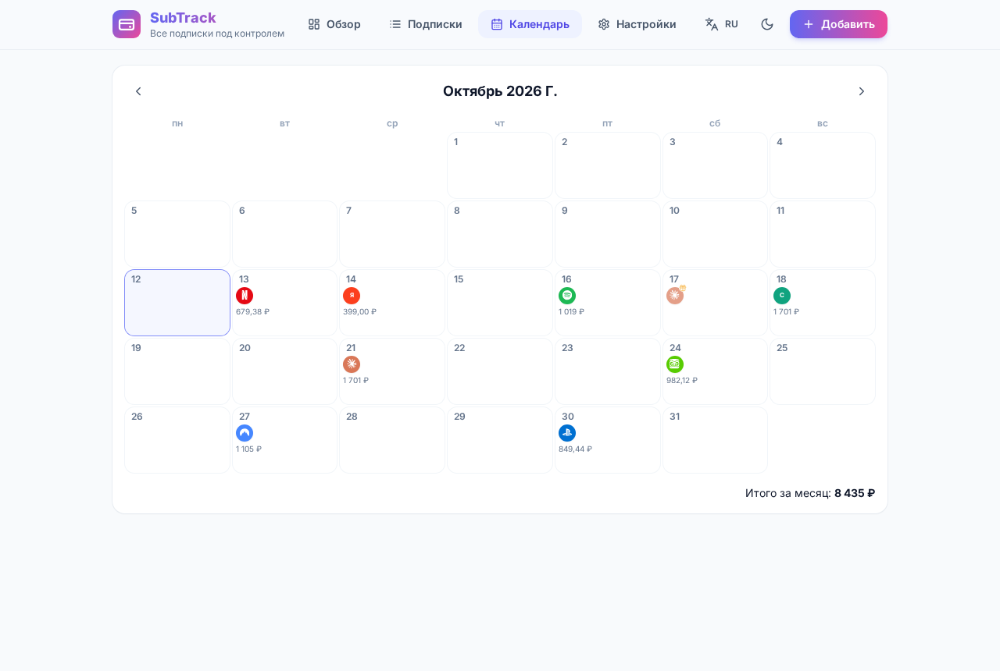
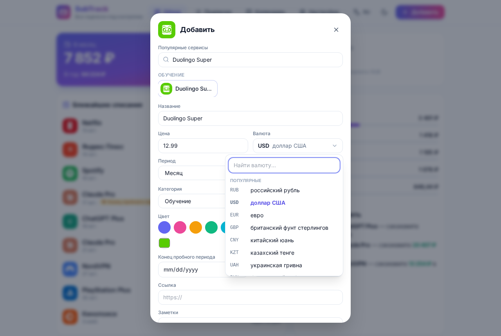
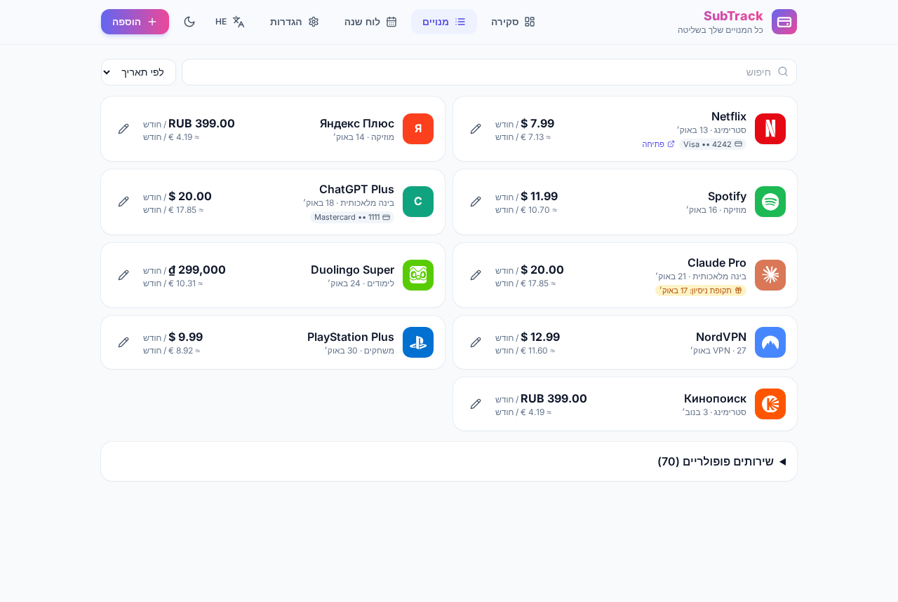
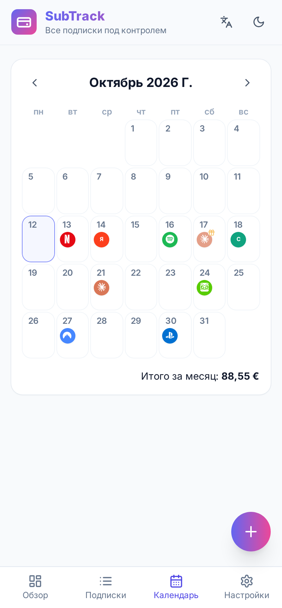

<div align="center">


**Offline subscription tracker for Android & Windows**

[Русский](README.md) · [English](README.en.md) · [Español](README.es.md) · [日本語](README.ja.md) · [Français](README.fr.md) · [Deutsch](README.de.md)

[](https://github.com/DanyaDanileckiy/subtrack/releases/download/v0.3.0/SubTrack-0.3.0-debug.apk)
[](https://github.com/DanyaDanileckiy/subtrack/releases/download/v0.3.0/SubTrack-Setup-0.3.0.exe)
[](https://github.com/DanyaDanileckiy/subtrack/releases/download/v0.3.0/SubTrack-Portable-0.3.0.exe)
[](LICENSE)

</div>

---

## About

A free open-source app for tracking subscriptions. Works **fully offline**, no sign-up, servers or analytics. All data stays on your device.



## Direct download links

| Platform | File | Link |
|----------|------|------|
| **Android** | `SubTrack-0.3.0-debug.apk` | [Download APK](https://github.com/DanyaDanileckiy/subtrack/releases/download/v0.3.0/SubTrack-0.3.0-debug.apk) |
| **Windows (installer)** | `SubTrack-Setup-0.3.0.exe` | [Download Setup](https://github.com/DanyaDanileckiy/subtrack/releases/download/v0.3.0/SubTrack-Setup-0.3.0.exe) |
| **Windows (portable)** | `SubTrack-Portable-0.3.0.exe` | [Download Portable](https://github.com/DanyaDanileckiy/subtrack/releases/download/v0.3.0/SubTrack-Portable-0.3.0.exe) |

> **Windows SmartScreen:** file is unsigned → “More info” → “Run anyway”.  
> **Android:** allow installs from unknown sources.

## Features

- Subscriptions with price, currency, period, charge date, category, color, logo, payment method and notes
- Correct handling of month-end dates (the 31st)
- Free trials with reminders
- Dashboard: monthly/yearly totals, category breakdown, “Cancel X to save Y a year” tips
- Charge calendar
- **166 currencies** with offline rates and manual override
- Reminders (local on Android, system on Windows)
- 70 popular services with logos
- **30 languages** (including RTL: Hebrew, Arabic)
- JSON / CSV export, light and dark theme

| | |
|---|---|
|  |  |
|  |  |

## Privacy

No accounts, analytics, ads or backend. The only network request is public exchange rates (open.er-api.com, no key).

## Build

```bash
npm install
npm run dev          # http://localhost:5173
npm run dist:win     # Windows Setup + Portable
npm run android:apk  # Android APK
```

**Stack:** React 18 · Vite · Tailwind CSS · Capacitor 7 · Electron

## License

MIT. Logos — [Simple Icons](https://simpleicons.org) (CC0).  
Changelog — [CHANGELOG.md](CHANGELOG.md).

<div align="center">

**Made with ❤️ for people who want to control their subscriptions without the cloud**

</div>
