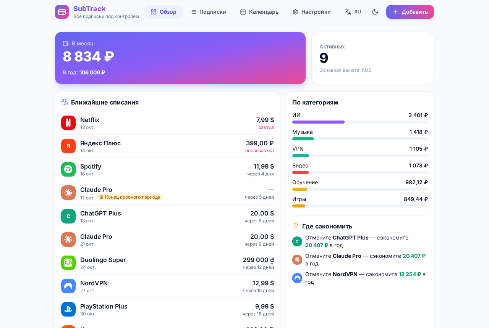

[Русский](README.md) · [English](README.en.md) · [Español](README.es.md) · [日本語](README.ja.md) · [Français](README.fr.md) · [Deutsch](README.de.md)

# SubTrack — gestor de suscripciones

Una aplicación gratuita y de código abierto para controlar tus suscripciones en Android y Windows. Funciona sin conexión, sin registro, sin servidores y sin claves de API. Todos los datos se quedan en tu dispositivo.



## Funciones
- Suscripciones con precio, moneda, periodo (semana / mes / año / personalizado), fecha de cobro, categoría, color, logotipo, método de pago, enlace y notas.
- Fechas de fin de mes correctas: una suscripción del día 31 se cobra el último día de los meses cortos y vuelve al 31.
- Pruebas gratuitas: fecha de fin con su propio recordatorio antes del primer cobro.
- Resumen: total mensual y anual en tu moneda base, desglose por categorías y consejos «Cancela X y ahorra Y al año».
- Calendario mensual de cobros con el total del mes.
- **Las 166 monedas** de open.er-api.com, con nombres localizados, búsqueda y monedas populares arriba. Sin conexión se usan los tipos guardados o una instantánea integrada para todas las monedas; cualquier tipo se puede fijar a mano.
- Recordatorios: notificaciones locales en Android y del sistema en Windows.
- 70 servicios populares con logotipos reales de Simple Icons.
- 30 idiomas, con RTL para hebreo y árabe.
- Exportación e importación JSON, exportación CSV para Excel o Google Sheets, tema claro y oscuro.

| | |
|---|---|
|  |  |
|  |  |

## Descargar
Descarga los archivos en [Releases](../../releases/latest): `SubTrack-0.3.0-debug.apk` (Android), `SubTrack-Setup-0.3.0.exe` (instalador de Windows) y `SubTrack-Portable-0.3.0.exe` (sin instalación). No están firmados: Windows SmartScreen puede avisar («Más información» → «Ejecutar de todas formas») y en Android hay que permitir orígenes desconocidos.

## Compilar
```bash
npm install
npm run dev          # http://localhost:5173
npm test
npm run dist:win     # Windows Setup + Portable (Linux: wine)
npm run android:apk  # Android debug APK (Android SDK + JDK 21)
```

Stack: React 18, Vite, Tailwind CSS, Capacitor 7, Electron, electron-builder.

## Privacidad
Sin cuentas, analítica, anuncios ni backend. La única petición de red obtiene tipos de cambio públicos (open.er-api.com, sin clave).

## Licencia
MIT. Los logotipos son de [Simple Icons](https://simpleicons.org) (CC0); las marcas pertenecen a sus dueños, consulta [NOTICE](NOTICE). Historial de cambios: [CHANGELOG](CHANGELOG.md).
