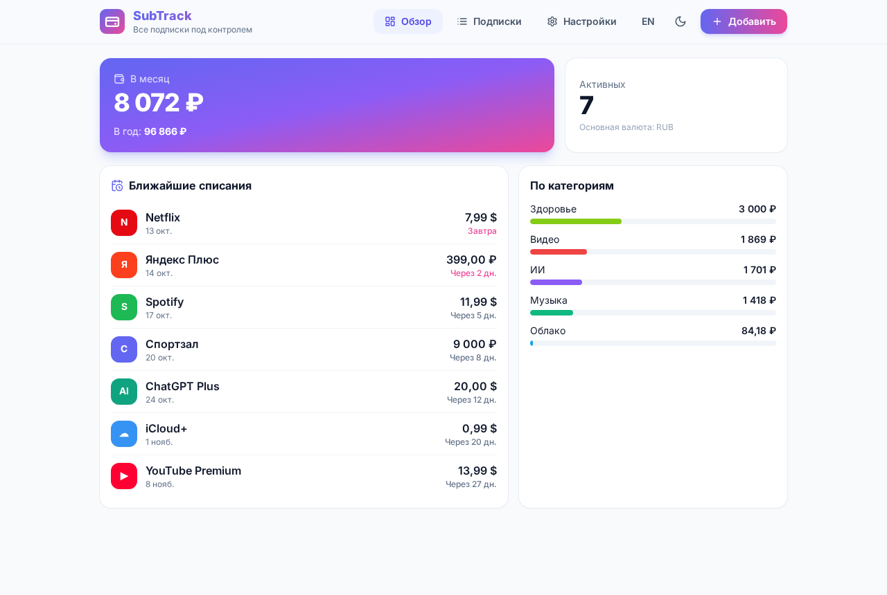
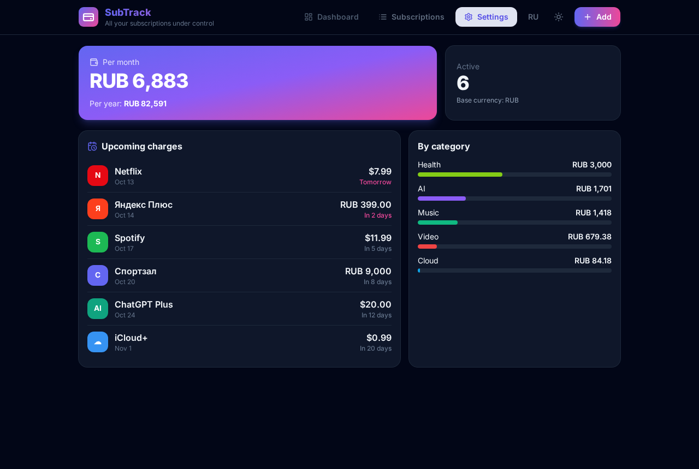
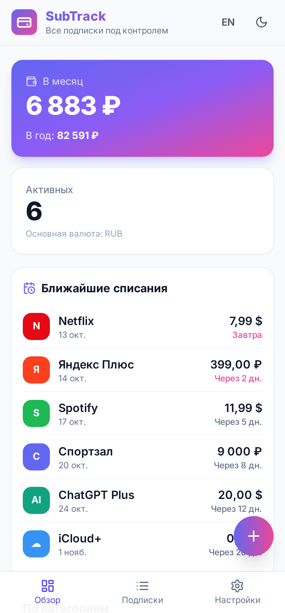

# SubTrack — трекер подписок

[Русский](#русский) · [English](#english)



## Русский

**SubTrack** — бесплатное open-source приложение для учёта подписок: Netflix, Spotify, Яндекс Плюс, ChatGPT и любых других. Работает на Android и Windows, полностью офлайн, без регистрации и серверов.

### Возможности
- Добавление, редактирование и удаление подписок: название, цена, валюта, период (неделя / месяц / год / свой, например «каждые 3 месяца»), дата следующего списания, категория, цвет и иконка.
- Обзор: сумма в месяц и в год в одной основной валюте, разбивка по категориям.
- Ближайшие списания на 30 дней; прошедшие даты автоматически переносятся на следующий период.
- Курсы валют из бесплатного API [open.er-api.com](https://open.er-api.com) (без ключа). Офлайн используются сохранённые курсы, а если их нет — встроенные приблизительные. Любой курс можно задать вручную.
- Напоминания за N дней до списания: локальные уведомления на Android, системные уведомления на Windows (пока приложение запущено).
- Шаблоны популярных сервисов: Netflix, Spotify, YouTube Premium, Яндекс Плюс, iCloud+, ChatGPT Plus, Кинопоиск, VK Музыка, Telegram Premium и др. (цены в шаблонах примерные — проверьте свои).
- Данные хранятся **только на устройстве**; экспорт и импорт в JSON.
- Светлая и тёмная тема, интерфейс на русском и английском.

### Скачать
Сборки в разделе [Releases](../../releases): `SubTrack-0.1.0-debug.apk` (Android, debug-сборка, без подписи для Google Play), `SubTrack-Setup-0.1.0.exe` (установщик Windows), `SubTrack-Portable-0.1.0.exe` (без установки). Exe не подписаны — Windows SmartScreen может показать предупреждение («Подробнее» → «Выполнить в любом случае»).

### Сборка из исходников
```bash
npm install
npm run dev          # веб-версия на http://localhost:5173
npm test             # юнит-тесты расчётов
npm run dist:win     # Windows Setup + Portable (на Linux нужен wine)
npm run android:apk  # debug APK (нужны Android SDK и JDK 21)
```

### Приватность
Никаких аккаунтов, аналитики, ключей API и бэкенда. Единственный сетевой запрос — получение публичных курсов валют.

---

## English

**SubTrack** is a free, open-source subscription tracker for Android and Windows. It works offline, with no sign-up and no servers.

### Features
- Add, edit and delete subscriptions with name, price, currency, billing period (week / month / year / custom such as "every 3 months"), next charge date, category, color and icon.
- A dashboard with monthly and yearly totals in one base currency, plus a per-category breakdown.
- Upcoming charges for the next 30 days. Past dates roll forward automatically.
- Exchange rates come from the free, keyless [open.er-api.com](https://open.er-api.com). Offline, the app uses cached rates, then built-in approximate rates. You can override any rate manually.
- Reminders N days before a charge: local notifications on Android, system notifications on Windows (while the app is running).
- Presets for popular services (Netflix, Spotify, YouTube Premium, Yandex Plus, iCloud+, ChatGPT Plus and more). Preset prices are approximate.
- Data stays **on your device only**, with JSON export and import.
- Light and dark theme. Russian (default) and English UI.

### Download
See [Releases](../../releases). The APK is a debug build. The Windows exe files are unsigned, so SmartScreen may warn you.

### Build
```bash
npm install && npm run dev
npm run dist:win     # Windows installer + portable
npm run android:apk  # Android debug APK
```

### Stack
React 18, Vite, Tailwind CSS, Capacitor 7 (Android, Local Notifications), Electron + electron-builder.

| | |
|---|---|
|  |  |

## License
[MIT](LICENSE)
